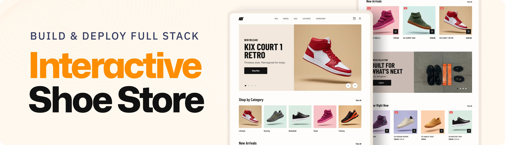
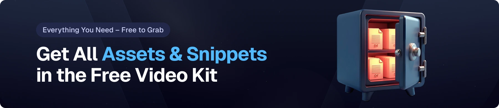

<div align="center">
  <br />
    <a href="https://youtu.be/xm0MCftqncA" target="_blank">
      
    </a>
  <br />

  <div>


<br/>


  </div>

  <h3 align="center">3D Sneaker Store | Custom Product Configurator</h3>

   <div align="center">
     Build this project step by step with our detailed tutorial on <a href="https://www.youtube.com/watch?v=XUkNR-JfHwo" target="_blank"><b>JavaScript Mastery</b></a> YouTube. Join the JSM family!
    </div>
</div>

## 📋 <a name="table">Table of Contents</a>

1. ✨ [Introduction](#introduction)
2. ⚙️ [Tech Stack](#tech-stack)
3. 🔋 [Features](#features)
4. 🤸 [Quick Start](#quick-start)
5. 🔗 [Assets](#links)
6. 🚀 [More](#more)

## 🚨 Tutorial

This repository contains the code corresponding to an in-depth tutorial available on our YouTube channel, <a href="https://youtu.be/xm0MCftqncA" target="_blank"><b>JavaScript Mastery</b></a>.

If you prefer visual learning, this is the perfect resource for you. Follow our tutorial to learn how to build projects like these step-by-step in a beginner-friendly manner!

<a href="" target="_blank"></a>

## <a name="introduction">✨ Introduction</a>

This is a 3D sneaker store with a real-time product configurator. Shoppers can spin any shoe, recolor parts like the laces and sole, and buy the exact pair they designed. The storefront is built with Astro, so pages ship almost no JavaScript and load instantly. Only the React Three Fiber customizer runs in the browser. Wix Headless powers the whole store backend: catalog, cart, checkout, member accounts and an owner dashboard. PostHog tracks where shoppers drop off, replays their sessions and runs A/B tests on whether 3D sells more.

The project is also built with an agent-driven workflow. The agent gets a project memory, writes plans you approve, has its diffs reviewed, and screenshots every page against the design until they match. You can reuse that workflow on any project after this one.

If you're getting started and need assistance or face any bugs, join our active Discord community with over **50k+** members. It's a place where people help each other out.

<a href="https://discord.com/invite/n6EdbFJ" target="_blank"></a>

## <a name="tech-stack">⚙️ Tech Stack</a>

- **[Astro](https://astro.build/)** is a content-focused web framework that renders pages to HTML on the server and ships almost zero JavaScript by default. Its islands architecture hydrates only the interactive components that need it. In this project, that means the storefront loads instantly and only the 3D customizer runs in the browser.

- **[React](https://react.dev/)** is a component-based JavaScript library for building interactive user interfaces. Here it powers the interactive islands inside the Astro pages, most importantly the 3D product configurator.

- **[Three.js](https://threejs.org/)** is a JavaScript library for rendering 3D graphics in the browser with WebGL. It handles the scene, lighting, materials and models behind every sneaker in the store.

- **[React Three Fiber](https://r3f.docs.pmnd.rs/)** is a React renderer for Three.js that lets you build 3D scenes declaratively with components and hooks. Together with Drei's ready-made helpers, it turns the sneaker models into a customizer where shoppers can rotate the shoe and recolor its parts.

- **[Wix Headless](https://jsm.dev/wix)** gives you Wix's commerce backend through APIs and SDKs while you build the frontend yourself. It provides the product catalog, categories, cart, checkout, member accounts, SEO and an owner dashboard, and the Wix CLI handles local development, builds and releases.

- **[PostHog](https://jsm.dev/kix-posthog)** is a product analytics platform that combines event tracking, funnels, session replays and feature flags. In this store it shows where shoppers drop off, replays their sessions, and runs A/B tests to measure whether the 3D experience sells more.

- **[TypeScript](https://www.typescriptlang.org/)** is a strongly typed superset of JavaScript that adds static type checking to your code. It catches errors during development and keeps the store's components, API calls and 3D logic reliable as the codebase grows.

- **[Tailwind CSS](https://tailwindcss.com/)** is a utility-first CSS framework for building custom designs directly in your markup. It keeps the storefront's styling consistent and responsive without switching between separate stylesheets.

## <a name="features">🔋 Features</a>

👉 **3D Product Viewer**: Spin and inspect every sneaker from any angle in a real-time 3D scene.

👉 **Part-by-Part Customizer**: Recolor individual parts of the shoe, like the laces and sole, and see the changes instantly.

👉 **Buy Your Exact Design**: The configuration you build carries into the cart, so you check out the exact pair you designed.

👉 **Product Catalog & Categories**: Browse sneakers by category, with product data managed in the Wix store backend.

👉 **Cart & Checkout**: A full cart and checkout flow powered by Wix eCommerce.

👉 **Member Accounts**: Shoppers can sign up, log in and manage their accounts.

👉 **Owner Dashboard**: Store owners manage products, orders and the business from a dedicated dashboard.

👉 **SEO Ready**: Server-rendered pages with SEO metadata managed through Wix.

👉 **Funnel Analytics & Session Replays**: See exactly where shoppers drop off and replay their sessions to understand why.

👉 **A/B Testing**: Run experiments to measure whether the 3D experience drives more sales.

👉 **Optimized 3D Models**: A built-in script compresses and optimizes the 3D models and textures so they load fast in the browser.

👉 **Near-Zero JavaScript Pages**: Astro ships static HTML and only hydrates the 3D customizer, keeping pages fast.

And many more, including code architecture and reusability.

## <a name="quick-start">🤸 Quick Start</a>

Follow these steps to set up the project locally on your machine.

**Prerequisites**

Make sure you have the following installed on your machine:

- [Git](https://git-scm.com/)
- [Node.js](https://nodejs.org/en)
- [npm](https://www.npmjs.com/) (Node Package Manager)

**Cloning the Repository**

```bash
git clone https://github.com/jsmastery-pro/kix.git
cd kix
```

**Installation**

Install the project dependencies using npm:

```bash
npm install
```

**Set Up Environment Variables**

Create a new file named `.env` in the root of your project and add the following content:

```env
WIX_CLOUD_PROVIDER="KUBERNETES"
WIX_CLIENT_ID=
WIX_CLIENT_INSTANCE_ID=
WIX_CLIENT_PUBLIC_KEY=
WIX_CLIENT_SECRET=

PUBLIC_POSTHOG_PROJECT_TOKEN=
PUBLIC_POSTHOG_HOST=https://us.i.posthog.com
```

Replace the placeholder values with your real credentials. You can get these by signing up at: [**Wix**](https://www.wix.com/) and [**PostHog**](https://posthog.com/).

**Running the Project**

```bash
npm run dev
```

Open [http://localhost:4321](http://localhost:4321) in your browser to view the project.

## <a name="links">🔗 Assets</a>

Assets and snippets used in the project can be found in the **[video kit](https://jsmastery.com/video-kit/e2bdc49f-a8bd-43be-ba52-948e8bc62f0a)**.

<a href="" target="_blank">
  
</a>

## <a name="more">🚀 More</a>

**Advance your skills with our Pro Course**

Enjoyed creating this project? Dive deeper into our PRO courses for a richer learning adventure. They're packed with
detailed explanations, cool features, and exercises to boost your skills. Give it a go!

<a href="hhttps://jsm.dev/kix-engineer" target="_blank">
  
</a>